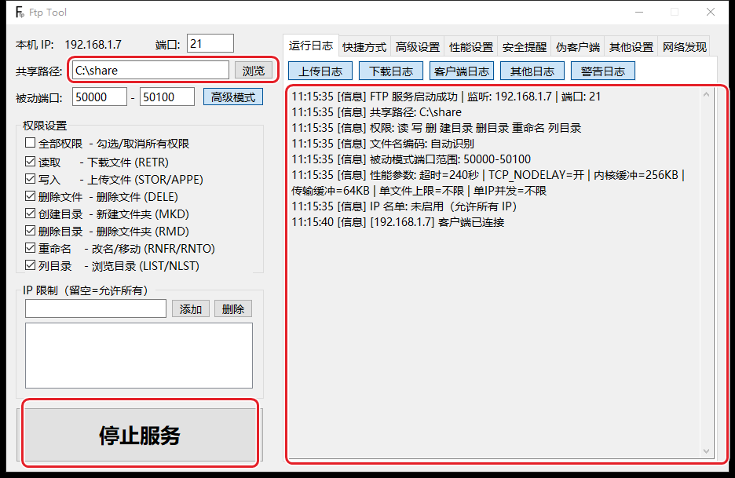
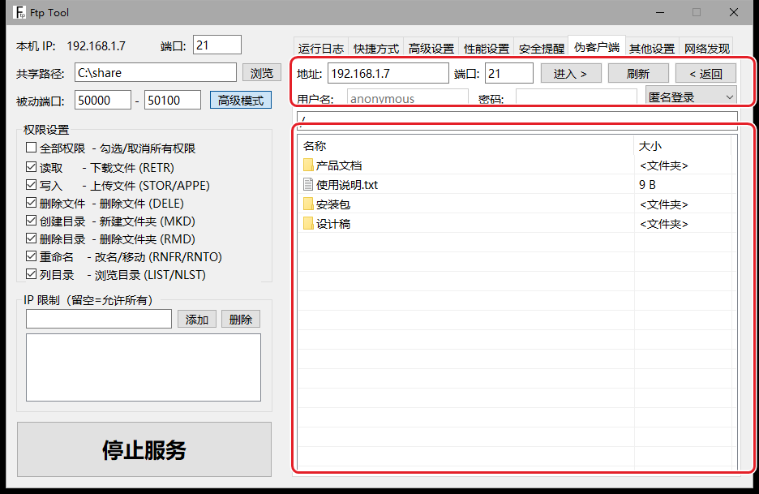
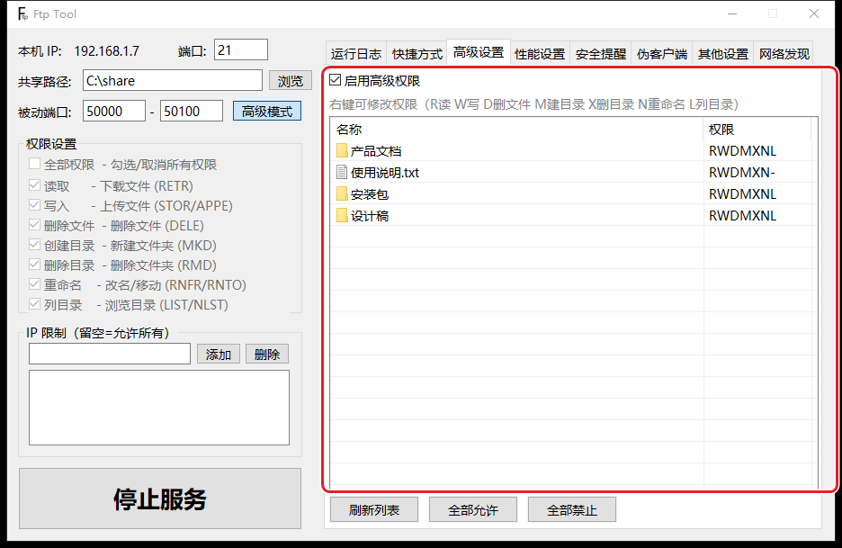
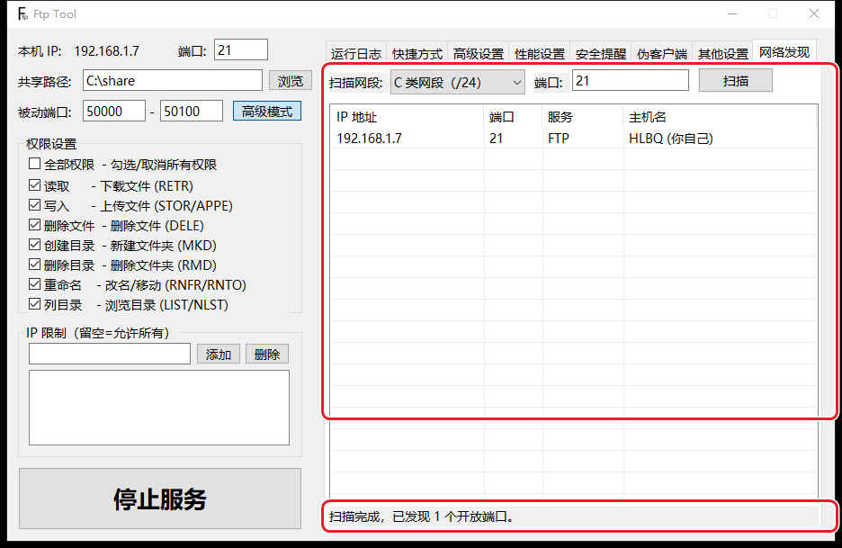
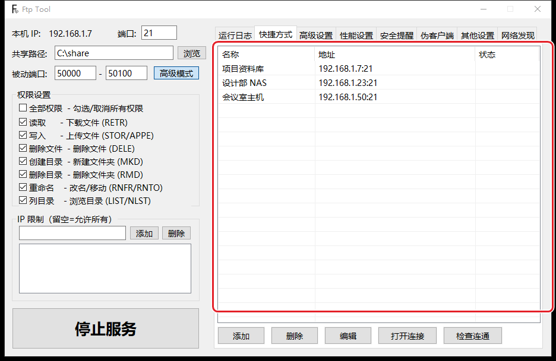
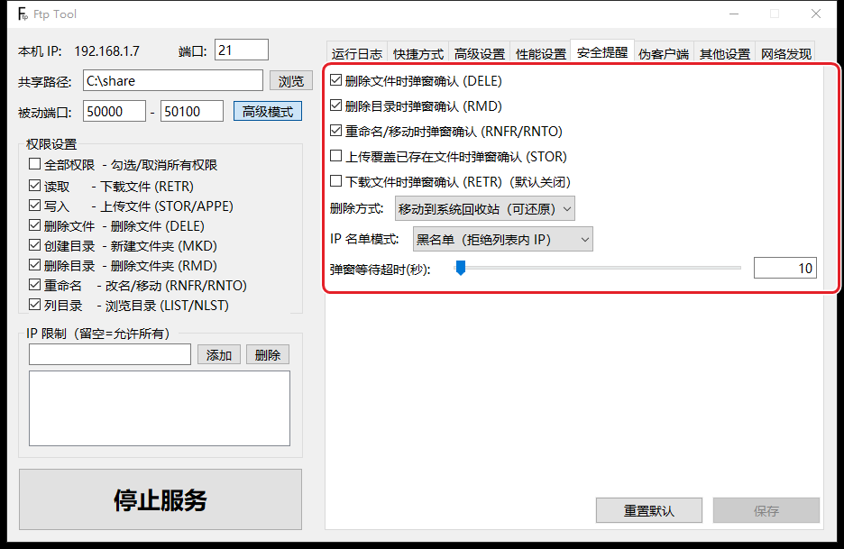
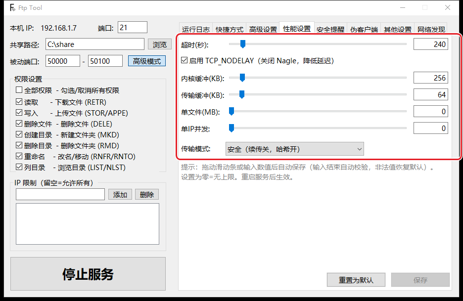
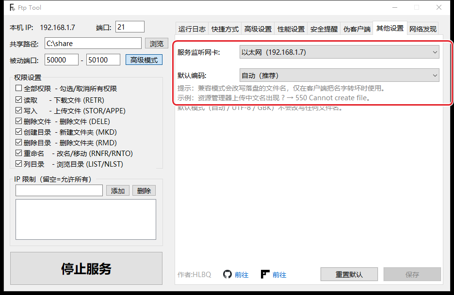

# Ftp Tool

**你已经会用 FTP 了。这个工具，是把 FTP 用得不再难受的那一步。**

用过 FTP 的人都知道：大部分情况它并没有预先安装，而是首次用之前，都得先忍一段——忍装软件、忍那个一言难尽的资源管理器客户端、忍只有一根进度条的传输、忍删完才发现删错、忍开了代理之后同事怎么都连不上。

Ftp Tool 不改变 FTP 本身，它把这些问题解决了：一个 exe 双击就开；自带客户端、文件拖进去就传；进度、速度、剩余时间都在眼前；删之前弹窗提醒。

---

## 为什么值得换掉你现在的做法

### 一、便携：一个文件，拷过去就能开

老办法开 FTP，先得找个服务端软件：下载、安装、选路径、改配置、处理防火墙，一套下来十几分钟。想揣在 U 盘里到处用？有点难度。

Ftp Tool 是**绿色单文件**——一个 exe，双击即开，配置就写在旁边的配置文件里，拷走就是完整的一套。要开服务：选文件夹、点“启动服务”，结束。

装软件这件事，本来就不该是使用文件服务的前提。

### 二、客户端：别再跟资源管理器较劲了

Windows 资源管理器自带的 FTP 客户端，用过的都有印象：地址输错一个字符，转圈转半天，然后硬控你两三分钟，期间只能干等；连上以后浏览、传输、重试全靠猜。

Ftp Tool 里带一个**自己的客户端**：左边服务器、右边本地，双击进目录，文件**可以直接拖出来**就是下载、拖进去就是上传。地址、端口、账号密码都摆在顶部，改完点“进入”立刻重连，不会让你等。

资源管理器不是不能用，是没必要再这么麻烦。

### 三、传输：进度、速度、剩余时间，一个都不少

资源管理器下载时给人的感觉是“迷茫”：只有一根进度条，不知道还要多久，也不知道是卡住了还是在走。

我们的上传和下载都有**完整的过程反馈**：百分比、实时速度、剩余时间、已传大小。传到一半断网，重连之后可以接着传（有哈希校验），不用从头再来。

### 四、权限：不是“能不能”，而是能到什么程度

很多简易工具有两个状态：全部放开，或者全部锁死。

Ftp Tool 把权限拆成七项——读取（下载）、写入（上传）、删除文件、创建目录、删除目录、重命名、列目录等等。

如果还不够细，高级设置里还能做**按文件、按目录的细粒度授权**：哪个目录谁能读、谁只能写，分得开。

### 五、内网：地址不用再手打

同一个局域网里天天互传文件的人，最烦的就是每次都要问一句“你 IP 多少”，再手动敲一遍 `ftp://...`。

Ftp Tool 有两个专门对付这件事的功能：

- **网络发现**：扫一遍网段，把正在提供服务的机器列出来，双击就能打开；
- **快捷方式**：常用的连接存成一条，下次点一下就连上，不用再回忆地址和端口。

这两个功能在同类工具里并不多见，但对“天天在内网倒文件”的人来说，省下的是每天重复几遍的那点烦躁。

### 六、删除，先问你一句

一般来说，工具要么不给删，要么点了就没了，没有中间地带。

Ftp Tool 在删除、重命名、覆盖、下载这些“危险动作”上都有**二次确认**，还能细分到只对某几类操作提醒。删除默认走**系统回收站**，不是一删永别——就像杀毒软件拦下文件那样，先弹个窗告诉你，手滑也有后悔的余地。这个思路在同类工具里，愿意做的人真不多。

同一页里还有**性能设置**：传输超时、缓冲区、并发数、单文件限制这些底层参数都能调。小文件多、大文件多、好几台机器同时连，可以按场景找平衡。

### 七、网络：开了代理，别人也找得到你

很多人踩过这个坑：电脑上开着代理或 VPN，或者有好几张网卡，服务明明起来了，别人却怎么都连不上——因为程序监听的网卡不对。

Ftp Tool 的**监听网卡**可以明确指定绑在哪块网卡上，默认会挑一个合适的本地网卡，不会因为代理类工具的存在而让你“隐身”。

文件名编码同样做了功课：中文名、全角括号、带符号的名字，尽量原样保存；实在无法还原的部分会明确提示，并且**保证文件本身传得上去**——不会出现“名字里有个括号，文件就传不了”这种事。

---

## 顺带说几件小事

- **实时日志**：谁连进来了、传了什么、删了什么，按类别分开记，出问题翻一眼就知道；
- **IP 限制**：白名单放行、黑名单拦截，临时给客户开个口子，传完删掉即可；
- **检查连通**：连不上时先在本地测一下，省得两边互相怀疑；
- **断点续传**：网络波动、程序重开，都能接着传。

---

## 三分钟上手

1. 双击 `FtpTool.exe`，不需要安装；
2. 选择要共享的文件夹；
3. 点“启动服务”。

窗口上会显示本机地址，例如 `ftp://192.168.1.x:21`。把这行发给对方，或者填进自己的客户端。

> 端口默认 21；改成 1024 以上的端口可以免去管理员权限。
> 首次运行如果系统防火墙弹提示，允许本程序访问网络即可。

---

## 适合谁

- 已经用过 FTP，但受够了现有工具的人；
- 经常在局域网里互相倒素材的工作室、机房、小组；
- 需要临时给别人开一个下载口子的场合；
- 想便携、不想在别人电脑上装东西的人。

---

## 干净，也有边界

- 单个 exe，不写系统目录，不需要额外运行库；
- 配置跟随程序，拷走即迁移；
- 只在局域网内提供服务，不会把文件发到任何外部服务器；
- 源码公开，做了什么、没做什么，都能自己核。

---

## 常见问题

**需要安装吗？**
不需要。双击运行，关掉窗口服务就停了。

**为什么安全软件会提示风险？**
监听网络端口是文件服务的正常行为，容易被启发式规则误判。源码公开、可以自行编译，添加信任即可。

---

## 获取

项目地址：<https://github.com/HLBQ/Simple-FTP-2>

作者网站：<https://heilibaiqi.top/>

作者：**HLBQ**

---

文中截图位于 `docs/images/`，用的是演示数据（`C:\share` 目录与几台示例主机）。如果你的截图更好看，直接替换同名文件即可，Markdown 引用不用动。
